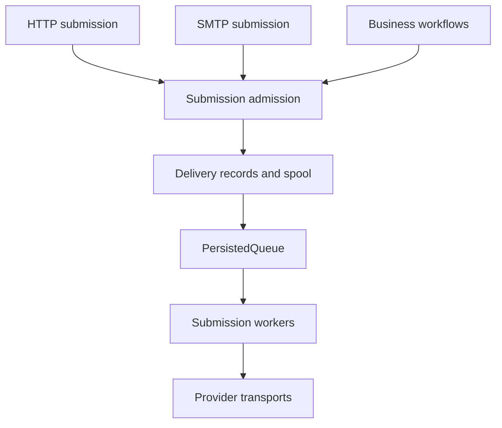

# Effect-native email: implementation plan

> Archived source plan from 2026-10-20. The active roadmap is
> `docs/service-improvement-plan.md`; current behavior is tracked in
> `docs/baseline-inventory.md`.

Date: 2026-10-20  
Status: proposed architecture and implementation backlog; no implementation has been performed  
Working name: `effect-email` (package availability and final naming not checked)  
Target: Effect v4, with the exact release pinned and its API verified in Phase 0  
Revision: queue-first durable submission, optional SMTP/HTTP gateway, and full upstream driver parity

## 1. Outcome and scope

Build an Effect-native email library using Unemail's provider integrations and domain behavior as the starting point. Preserve normalized messages, provider-specific payload handling, native batching, positional results, and isolated partial failures. Replace custom execution infrastructure with Effect services, layers, schedules, streams, resources, logging, tracing, and typed errors.

Provide four independently usable surfaces over shared domain contracts:

1. **Immediate submission:** prepare and send within the current operation.
2. **Queued submission:** persist delivery intent and process it with Effect `PersistedQueue`, without requiring Workflow.
3. **Durable orchestration:** coordinate business decisions, timers, and external events with Workflow; delegate through `DurableQueue` only when a separate worker boundary is useful.
4. **Submission gateway:** accept authorized mail through HTTP and SMTP and hand it to the same durable admission service.

Full native conversion of every driver in the pinned upstream revision is an explicit completion milestone, covering provider transports, platform bindings, local/testing drivers, generic HTTP, and composites. Earlier independent releases are permitted; they must identify the remaining parity backlog.

The immediate library must not require SQL, Redis, Workflow, or a worker. Queue, workflow, HTTP server, and SMTP server modules are optional imports. The initial server product is an authenticated application submission gateway and a development catcher. Public MX hosting and direct-to-MX delivery are separate future capabilities.

An accepted submission is not confirmed delivery. Name and document these states separately throughout the API.

### Non-goals for the first release

- Building a marketing automation platform or inbox client.
- Exactly-once delivery guarantees across arbitrary providers.
- Making every provider-specific feature portable through a universal message object.
- Reimplementing Effect's general dependency injection or middleware framework.
- Shipping a separate service for every pure function.
- Porting every provider before the contracts and batch engine are validated.
- Running a public internet mail exchanger, mailbox service, or direct-to-MX delivery engine in the initial release.

## 2. Evidence and constraints

The prior inspection used the Unemail repository tree at commit `4d539b1590776fc68ab19653597f21f1b3ceb24b`. Individual file reads used the then-current default branch; Phase 0 must pin a checkout and check for differences before implementation. The design below is a proposal, not an assertion that these APIs already exist.

Relevant inspected upstream components:

| Source | Behavior to preserve or improve |
| --- | --- |
| `src/core/types.ts` | Input/normalized message separation, driver features, positional batch outcomes |
| `src/core/message.ts` and `address.ts` | Normalization and address/header domain behavior; audit during Phase 0 |
| `src/core/define.ts` | Provider capability checks, result-count checks, handler composition |
| `src/core/email.ts` | Routing, defaults, normalization, transport lifecycle |
| `src/middleware/retry.ts` | Retrying failed positions rather than resending successful messages |
| `src/middleware/idempotency.ts` | Success-result reuse; strengthen atomicity and uncertainty handling |
| `src/drivers/fallback.ts` | Per-message fallback and preservation of successful outcomes |
| `src/drivers/resend.ts` | Native batch limits, attachment-specific submission paths, response mapping |
| `docs/architecture.md` | Destination-scoped state and batch invariants |

Do not copy claims about provider limits or supported features into a new release without checking current provider documentation. Retain upstream MIT attribution and license obligations for reused code. Preserve protocol behavior through regression fixtures before replacing implementation machinery.

## 3. Core architectural decisions

### 3.1 Three public boundaries

| Boundary | Input | Output | Responsibilities |
| --- | --- | --- | --- |
| Message preparation | Raw input plus explicit defaults | Prepared message or validation error | Rendering, normalization, address parsing, header checks |
| Transport | Prepared message/envelope | Submission receipt or transport failure | Provider translation, endpoint selection, I/O, response decoding |
| Email service | Application message input | Receipt or application-facing email error | Preparation, named route selection, invocation of transport policies |

Use a pure `Message` module for data transformations and schemas. Use `EmailTransport` as the dependency-injected transport contract. Use `Email` as the normal application-facing service. Provider modules export effectful constructors and layers.

Separate message data from delivery metadata. The provider envelope carries a stable logical message ID, operation ID, destination ID, and provider idempotency key. Attempt counters and tracing attributes do not belong in mutable message objects.

### 3.2 Services and implementation values

An application normally requires one `Email` service. A provider implementation is a transport value. A provider layer supplies that value under the shared `EmailTransport` key. Every concrete driver module exposes an Effect constructor and an appropriate layer/service integration. Provider-specific `Client` services expose concrete capabilities when useful and share the same underlying instance with the generic transport; Section 19 defines the construction contract.

When using multiple providers, construct multiple values and compose them before providing the final service. Merging two layers with the same service key does not create a registry.

Support explicit named routes such as `transactional` and `broadcast` through an immutable route table. Keep a dynamic route registry out of the MVP. If runtime changes become necessary, introduce a separately managed scoped registry later.

### 3.3 Construction and lifetime

- Provider `make` constructors may require `HttpClient`, configuration, platform bindings, and `Scope` when they acquire resources.
- Provider `layer` constructors own acquisition and release through Effect's layer/scoped resource mechanisms.
- Capture stable dependencies during construction; keep ordinary send operations free of low-level construction dependencies.
- SMTP pools, connection health fibers, breaker state, and quota clients live in the constructed transport's scope.
- Construct long-lived layers once at the application boundary. Do not rebuild a transport for each send.
- Initialize eagerly by default. If lazy standby initialization is needed, implement it explicitly with single-flight acquisition and scoped release; layer construction alone does not guarantee lazy acquisition.
- Provider credentials use `Config`/`Redacted` where appropriate and must never appear in diagnostics.

### 3.4 Package layout

Start as one package with subpath exports. Split packages only when platform dependencies or release cadence justify it.

| Module/subpath | Contents |
| --- | --- |
| `Message` | Schemas, brands, parsing, normalization, pure combinators |
| `Email` | Application service, accessors, layer construction |
| `EmailTransport` | Core contract, batch extensions, routing/composition |
| `EmailError` | Typed failure taxonomy and classification |
| `Submission` | Receipts, positional outcomes, message identities |
| `providers/Resend`, `providers/Ses`, etc. | Provider constructors, layers, codecs |
| `render/Template`, `render/React` | Typed rendering with optional framework dependencies |
| `policy/Retry`, `policy/CircuitBreaker` | Email-specific policy over Effect primitives |
| `delivery/*` | Delivery intent, submission admission, attempt history, reconciliation |
| `queue/*` | PersistedQueue construction, submission workers, retry classification |
| `workflow/*` | Workflow definitions and optional DurableQueue worker delegation |
| `gateway/Http` | HTTP submission, status, cancellation, health, administration |
| `gateway/Smtp` | SMTP protocol, sessions, authentication, admission adapter |
| `spool/*` | Raw message and attachment storage, staging/finalization/cleanup |
| `testing/*` | Recording transport, scripted outcomes, contract test kit |
| `compat/Unemail` | Optional bridge, with explicit limitations |

Keep Node-only SMTP imports out of common entrypoints. Rendering integrations and durable storage adapters must remain opt-in imports. Verify emitted exports and dependency reachability, rather than assuming bundlers remove everything.

## 4. Proposed public contracts

These signatures communicate the intended contract. Compile all final examples against the pinned Effect release before committing to exact helper names or generic ordering.

```ts
interface Transport {
  readonly destination: Destination
  readonly send: (
    envelope: PreparedEnvelope
  ) => Effect.Effect<SubmissionReceipt, TransportError>
}

interface NativeBatchTransport extends Transport {
  readonly sendBatch: (
    envelopes: ReadonlyArray<PreparedEnvelope>
  ) => Effect.Effect<ReadonlyArray<SubmissionOutcome>, BatchExecutionError>
}

class EmailTransport extends Context.Service<EmailTransport, Transport>()(
  "@effect-email/EmailTransport"
) {}
```

Use a runtime-refinable extension for native batch support, together with capability metadata. Avoid requiring native batching in every driver. A generic batch interpreter can invoke single sends with bounded concurrency when no suitable native endpoint exists.

Application functions:

```ts
Email.send(input)
// Effect<SubmissionReceipt, EmailError, Email>

Email.sendBatch(inputs, options)
// Effect<ReadonlyArray<MessageOutcome>, BatchExecutionError, Email>

Email.sendStream(source, options)
// Stream<MessageOutcome, SourceError | BatchExecutionError, Email | SourceServices>

Submission.enqueue(input, options)
// Effect<AdmissionReceipt, AdmissionError, SubmissionAdmission>

Submission.get(deliveryId)
// Effect<DeliveryRecord, LookupError, DeliveryStore>
```

For `sendBatch`, validation failures occupy their own input slots. Define the operation so callers do not lose successful outcomes when other slots fail. Outer errors are reserved for infrastructure/orchestration failures where the operation cannot account for all requested inputs; such errors must contain known partial progress when available.

Interruption remains an Effect interruption. Document that an interrupted operation may already have submitted some messages; callers needing restart recovery should use durable delivery.

### 4.1 Message schemas and brands

Implement schemas for mailbox input, normalized addresses, attachments, content variants, provider receipts, and durable payloads. Brand normalized addresses and IDs where this prevents confusion. Do not imply that a parsed address proves mailbox existence or deliverability.

Use discriminated content forms instead of a bag where arbitrary combinations are always accepted:

- Rendered body: text, HTML, or both.
- Registered local template: template key/version and typed props.
- Provider-hosted template: provider-specific reference and variables.
- Raw MIME: explicit transport capability, bypass rules documented.

Enforce attachment content-versus-URL exclusivity, explicit string encoding, and header/address invariants. Reuse audited parsing logic as Schema transformations/refinements where sensible; Schema is not itself an RFC mailbox parser.

Distinguish raw input, rendered draft, and prepared message. Effects introduced by renderers stay visible in preparation's error/dependency types. Prevent invalid post-validation mutation by keeping prepared messages immutable and requiring revalidation for transformations that affect invariants.

### 4.2 Receipts and identifiers

A `SubmissionReceipt` contains at least:

- Logical delivery/message ID when supplied.
- Provider name and stable destination/account identifier.
- Provider message ID.
- Acceptance timestamp.
- Route and request correlation ID when available.
- Optional decoded provider extension data.

`retrieve` and `cancel` consume a receipt/reference that identifies the original destination. Never retrieve a fallback receipt through whichever provider happens to be configured as primary today.

Use distinct types for logical delivery ID, provider message ID, and workflow execution ID. The implementation may derive one from another but must not treat them as interchangeable.

### 4.3 Error taxonomy

Expected errors should be tagged and schema-serializable when persisted. Candidate cases: `InvalidMessage`, `UnsupportedCapability`, `AuthenticationFailed`, `RateLimited`, `ProviderRejected`, `TransportUnavailable`, `DeliveryUncertain`, `IdempotencyConflict`, `StoreUnavailable`, and `MalformedProviderResponse`.

Represent submission certainty separately from retry advice:

| Submission state | Interpretation | Default policy |
| --- | --- | --- |
| `not-submitted` | Local failure before submission was possible | Retry/fallback if otherwise eligible |
| `rejected` | Provider definitively refused the request/message | Classify refusal; retry only if appropriate |
| `unknown` | Request may have been accepted | Reconcile or retry with supported idempotency; no blind cross-provider failover |

Preserve `Retry-After`, status, request ID, and safe provider error details as typed fields. Decode seconds and HTTP-date forms. Never shorten a provider's required wait merely to satisfy a local backoff cap: defer or fail within the operation deadline instead.

Do not convert every defect into an ordinary retryable provider error. Decoder failures and unexpected adapter exceptions need explicit handling; programmer defects should remain visible. Do not flatten fiber interruption into an ordinary `Cancelled` email failure in the native API.

## 5. Composition API and rules

### 5.1 Pure message composition

```ts
const input = Message.make({
  to: customer.email,
  subject: "Your receipt",
  text: receiptText
}).pipe(
  Message.setFrom("billing@example.com"),
  Message.addTag("transactional"),
  Message.withDeliveryId(`receipt:${order.id}`)
)
```

Expose data-first and data-last functions where it improves ergonomics. Avoid deep generic machinery solely to make every function pipeable. The final preparation step validates the composed message.

### 5.2 Transport policies

Stateless decorators are ordinary transport-to-transport functions. Stateful policies return an Effect that constructs a decorated transport and allocates shared state once. Preserve capabilities when decorators preserve behavior; transform capability metadata when behavior changes.

```ts
const makePrimary = Resend.make(options).pipe(
  Effect.flatMap(EmailTransport.withRateLimit(quota)),
  Effect.flatMap(EmailTransport.withCircuitBreaker(breaker)),
  Effect.map(EmailTransport.withRetry(retryPolicy))
)
```

The proposed order above places retry outside the breaker and limiter. Each actual attempt traverses the inner policies. Implement batch-aware policy handling so partial failures are inspected rather than hidden inside a successful array.

Document effective nesting with executable examples. Define whether the breaker counts actual failed requests, failed messages, or exhausted logical sends. Default to request-level health observations where provider requests are the health unit; do not turn one failed batch HTTP call into hundreds of breaker failures.

### 5.3 Standard Effect composition

Use standard Effect operators at application call sites for spans, deadlines, error recovery, provisioning, and concurrency. Internal modules must never call `runPromise` or create an independent runtime per operation. Promise interop belongs at explicit external boundaries.

### 5.4 Fallback and execution plans

Evaluate Effect's `ExecutionPlan` for ordered provider attempts and retry schedules. Apply it to the smallest safe provider submission unit. It does not replace batch outcome reconciliation or uncertainty rules.

Phase 0 must produce a short decision record comparing:

1. ExecutionPlan-driven single submissions plus a specialized batch interpreter.
2. One specialized batch interpreter that also handles single-element sends.

Prefer the second if the first duplicates policy logic or compromises native batching. Public callers should not need to know which interpreter is used.

Round-robin selects a provider once per logical send; retries should retain that selection unless fallback policy explicitly changes it. Tee/mirror is an explicit multiple-submission operation with multiple receipts, not an ordinary one-receipt send. Default test mirroring should redirect recipients to a sink rather than accidentally deliver duplicates.

## 6. Batch engine implementation

Build one deterministic indexed execution algorithm used by immediate batches and bounded stream chunks.

1. Assign immutable input indices and logical IDs.
2. Prepare each message independently; retain preparation failures in place.
3. Resolve routes and destination identities.
4. Check per-message endpoint capabilities.
5. Partition by destination, compatible endpoint, and relevant batch constraints.
6. Chunk by current provider limits, including recipient and payload-size limits where applicable.
7. Acquire quotas according to configured request/message/recipient costs.
8. Execute requests with bounded concurrency and interruptible I/O.
9. Decode outcomes and reconcile provider IDs to original indices.
10. Select only safely retryable unresolved indices; respect individual or grouped retry deadlines.
11. Route eligible failures to the next provider; retain all completed outcomes.
12. Reassemble one outcome per original input in original order.

Native batch success is not the same as all-message success. Policies must inspect per-message failures. If response cardinality or correlation is malformed, preserve independently trustworthy acknowledgements and mark unresolved slots uncertain; do not reinterpret a malformed response as evidence that nothing was sent.

Provider idempotency may be request-scoped. Stable membership, payload, and keys matter: retrying a changed subset under a new batch key may not retain the original deduplication guarantee. Model provider idempotency scope and validity window explicitly, and test this before permitting automatic subset retries after ambiguous failures.

For `sendStream`, bound input chunk size, active requests, and result buffering. Expose ordered results by default. Document head-of-line blocking and add unordered indexed results only if justified. Stop pulling from the source when downstream backpressure or interruption requires it.

## 7. Capabilities and routing

Use method interfaces for operations and runtime metadata for message/endpoint constraints. Static types should reject clearly unsupported operations for concrete providers, without forcing application code into enormous provider unions.

Metadata must distinguish:

- Single send versus native batch constraints.
- Local rendering versus provider-hosted templates.
- Native provider scheduling versus orchestration scheduling.
- Idempotency support, request scope, and retention window.
- Attachments, remote attachment URLs, raw MIME, tracking, and custom headers.
- Retrieval and cancellation, including provider state restrictions.

Static configuration can preserve route keys through literal types. Dynamic configuration must use checked route lookup and runtime capability validation.

Composite capability metadata must reflect routing guarantees. A fallback can expose a capability only if it restricts its eligible legs appropriately or guarantees support across those legs. A round-robin route must not randomly select an incompatible provider.

Destination identity includes provider plus account/tenant/binding configuration identity, with stream/quota partitions as needed. Provider name alone is insufficient for breaker isolation, credentials, receipt routing, or rate limits. Shared quotas should intentionally share a key even when several routes use the same account.

## 8. Rendering

Provide typed template definitions with a props Schema, stable template ID, version, and rendering function. Rendering can require services and return typed failures.

Keep React Email and other engines behind optional adapters. Test module imports without those adapters installed. A renderer returns HTML/text; HTML-to-text fallback is an explicit configurable behavior with predictable output.

Do not persist React elements in workflow payloads. Durable messages store either rendered content or a versioned template reference with validated serializable props. Store attachment references rather than large inline blobs where appropriate. Version retained template implementations or snapshot output so replays do not silently change content.

Rendering and suppression checks occur before provider submission, outside retry loops unless a policy explicitly requires recomputation. Retrying an HTTP call must not nondeterministically render different content under the same idempotency key.

## 9. Queue-first durable delivery and persistence

### 9.1 Responsibilities and execution modes

`PersistedQueue` is the default asynchronous work mechanism. Workflow is an optional orchestration interpreter. Do not introduce a custom general-purpose queue or require one workflow execution for every ordinary queued email.

| Component | Responsibility | Must not duplicate |
| --- | --- | --- |
| `SubmissionAdmission` | Validate/authorize, fingerprint, persist an intent, arrange durable work | Provider submission |
| `PersistedQueue` | Work storage, scoped processing, worker locks, acknowledgement, infrastructure redelivery | Business delivery history |
| `DeliveryStore` | Intent state, attempt evidence, receipts, cancellation, uncertainty, events | Generic queue leases/polling |
| Transactional outbox | Atomic business-write-to-dispatch handoff where needed | Provider idempotency |
| Workflow | Durable business sequencing, timers, decisions, waiting for events | Ordinary background-job dispatch |
| `DurableQueue` | Typed request/result bridge from Workflow to separate workers | A second delivery identity |

Immediate sends remain independently usable. Queue and workflow paths converge on the same domain submission function and transport adapters.



### 9.2 PersistedQueue integration

The inspected v4 module provides schema encoding, named queues, custom IDs, delayed offers, attempt-based retry schedules, scoped `take(handler)`, and memory/Redis/SQL stores. It is marked unstable. Pin and verify concrete behavior before implementation. Memory storage is volatile and suitable for tests, not a production durability claim.

Use small versioned jobs pointing to authoritative intent data:

```ts
// Proposed job model
interface SubmissionJob {
  readonly version: 1
  readonly tenantId: TenantId
  readonly deliveryId: DeliveryId
  readonly dispatchGeneration: number
}

// Existing Effect API; SubmissionJobSchema is supplied by this library
const makeQueue = PersistedQueue.make({
  name: "email.submissions.v1",
  schema: SubmissionJobSchema,
  maxAttempts: 10
})
```

Queue IDs derive from tenant, delivery ID, and dispatch generation. Keep the logical provider idempotency identity stable across safe attempts; queue generations identify distinct dispatch work, not a new intended email. A legitimate later action must not be suppressed by the deduplication record of an earlier queue job. Conflicting payloads under one delivery ID are rejected by admission before offering work.

Construct a typed queue service at application startup. Worker fibers repeatedly perform scoped takes with bounded concurrency; long-running worker loops must recover from store errors instead of silently terminating. Queue processing lifetime ends only after the handler has finished required durable writes. Never return success and leave submission running in a detached fiber.

### 9.3 Acknowledgement and retry semantics

| Domain outcome | Durable action | Queue handler result |
| --- | --- | --- |
| Already accepted or canceled | Return existing terminal result | Success; acknowledge |
| Newly accepted | Persist receipt and attempt evidence | Success only after persistence |
| Permanent rejection | Persist terminal rejection | Success; work was handled |
| Unknown acceptance | Persist uncertainty and durable reconciliation intent | Success after handoff is durable |
| Safe transient submission failure | Persist classified attempt, then retry/defer | Fail only when queue retry is the designated owner |
| Store unavailable before provider I/O | No provider call | Fail for infrastructure redelivery |
| Store unavailable after possible acceptance | Recover using stable attempt/provider key | Redelivery must reconcile, not blindly resend |

Catching a failure and returning success changes acknowledgement behavior. Keep classification in a dedicated interpreter rather than ad hoc catch-all handlers. On redelivery, inspect intent and attempt state before I/O. Persist attempt identity and selected destination before the external call. A crash after attempt-start but before the actual call can still be conservatively uncertain; define reconciliation/retry rules for that boundary.

Queue infrastructure retries, submission retries, and business retries have different owners. Permit short safe transport retries within a total budget. Use persisted work for longer infrastructure delays. Use Workflow for business timers. Keep total attempts and expiry in the domain record so restarting or changing queue generations cannot reset the delivery budget.

The inspected queue schedule takes the persisted attempt number; provider-specific `Retry-After` is not automatically its input. Implement an explicit durable `nextAttemptAt` path for variable provider delays, with an atomic due-work/outbox handoff or a verified custom queue extension. Do not claim arbitrary dynamic rescheduling is supplied by the basic API. Enforce business deadlines against actual timestamps; a replayed attempt schedule is not itself an elapsed-wall-clock deadline.

### 9.4 Queue limits, batching, and operational recovery

The public `take` abstraction processes one queued value per scoped handler. It does not automatically expose a lease-aware bulk dequeue. Do not acknowledge several jobs early merely to accumulate a provider batch.

Initial worker implementation submits individual jobs safely. Preserve native batching for immediate batch APIs. Add queued native batching as a separate optimization with one of two explicit strategies:

- Persist a stable chunk job with stable membership; the handler uses the indexed batch engine and durable per-member outcomes. Redelivery skips definitively accepted members and handles ambiguous batch keys conservatively.
- Implement a verified scoped bulk-processing adapter that holds all processing windows until corresponding outcomes are persisted.

Select chunking only after measuring throughput and confirming provider idempotency scope. Do not merge unrelated SMTP transactions into one all-or-nothing domain intent.

Provide failed-work inspection, controlled redrive, backlog/oldest-job metrics, and a domain reconciliation scan. Verify the pinned module's dead-letter inspection/requeue facilities; a management adapter may be necessary. Redrive preserves logical delivery identity and records an operator action. Completed queue IDs have finite retention, so durable delivery tombstones must enforce any longer application deduplication policy.

Run queue cleanup deliberately and document completed/failed retention. Test expired worker locks, lock refresh failure, process termination, and clock behavior of the selected backend. Infrastructure locks are not external-provider fencing.

### 9.5 DeliveryStore contract

Remove the earlier plan's separate generic `claim`, lease refresh, and due-job polling subsystem unless a demonstrated multi-entrypoint race requires it. `PersistedQueue` owns ordinary processing leases. DeliveryStore owns atomic domain transitions and may compare-and-set an attempt generation to reject stale local writes.

Required operations:

- `createIntent`: namespaced ID plus payload fingerprint; identical replay returns existing data, conflicting content fails.
- `beginAttempt`: atomically record stable attempt identity, dispatch generation, selected destination, and submission key.
- `recordAccepted`, `recordRejected`, `recordUncertain`: record evidence with current-attempt checks.
- `recordDeferred`: record actual next-attempt time and durable dispatch/reconciliation intent.
- `requestCancellation`: record desired cancellation separately from provider cancellation outcome.
- `get`, `listUncertain`, and query projections for operations and recovery.
- `appendProviderEvent`: deduplicate verified events and correlate them to receipts.

If immediate and queued interfaces can address the same logical delivery, route both through a common identity-aware submission coordinator or explicitly disallow mixing them. Compare-and-set local state does not stop a stale process from sending externally; provider idempotency and uncertainty rules remain necessary.

Use separate intent, attempt, receipt, event, and outbox records. Preserve event history: delivered, opened, and clicked are not one strictly increasing state machine. Supply in-memory test and PostgreSQL reference adapters first.

### 9.6 Transactional admission and outbox

First spike whether the SQL queue's `offer` runs inside the application's existing SQL transaction on the exact same client/connection context. Prove rollback and commit behavior with integration tests. If it does, a business write, intent, and queue offer may commit atomically without a separate generic outbox table.

If queue offers cannot join that transaction, use an outbox. Commit business state and intent/outbox together; publish a stable queue ID; mark the outbox published. A crash between publication and marking causes safe repeat publication within deduplication retention. Ensure backlog/retention policy does not create a silent replay hole.

Redis queue mode generally requires the database outbox boundary for atomic handoff from SQL application state. Do not assume that sharing a host or calling two Effects sequentially makes a distributed transaction.

An accepted enqueue API call returns an admission receipt identifying persisted responsibility. It does not return a fabricated provider receipt.

### 9.7 Workflow and DurableQueue integration

Use Workflow for sequences such as wait-until-due, recheck invoice status, send, await event, and send a reminder. For simple due-time submission, a delayed queue job can be sufficient if deadline/clock semantics and cancellation are acceptable.

Use an activity when the workflow can submit directly in its own process. Use `DurableQueue` when delegating submission to a separately deployed worker pool is valuable. Its worker input must carry the same logical delivery identity. Both paths invoke the same idempotency-aware domain submission function.

The inspected DurableQueue implementation links persisted work to a DurableDeferred result. Exhausted work can remain dead-lettered with the waiting workflow parked. Implement visibility, redrive, reconciliation, and an explicit domain terminal-failure protocol. Do not assume dead-lettering automatically resolves the workflow as a typed error.

Avoid applying two queue layers automatically: an ordinary queued job need not start a workflow that enqueues the same submission again. Keep execution IDs, delivery IDs, and queue job IDs distinct. Activity names and payload schemas are versioned; retain compatibility for in-flight work during deployments.

Persist serializable template references/props or rendered snapshots and attachment references. Check suppression and cancellation near submission time. Never claim a memoized activity result closes the provider-acceptance-before-persistence crash window.

### 9.8 Provider events, cancellation, and retention

Authenticate webhooks, deduplicate them, and persist before responding successfully. Events arriving before a workflow begins waiting must remain visible. Events after workflow completion must update delivery projections independently.

Canceling pending work suppresses future submission when the worker reads intent state. Canceling provider-scheduled work invokes the original provider's cancellation capability. Record races and the actual outcome; accepted email may not be recallable.

Set separate retention policies for body/blob data, delivery tombstones, attempts, provider events, queue completed IDs, queue failures, and workflow histories. Body deletion must not erase identity evidence required to prevent resend. Secrets never belong in job payloads or message records.

## 10. Observability and testing

### Observability

- One logical delivery span, child submission-attempt spans, and provider-request spans.
- Distinguish acceptance latency, queue delay, retry delay, and confirmed-delivery latency.
- Metrics: accepted/rejected/uncertain counts, attempts, batch sizes, active requests, quota waits, breaker transitions, backlog age, and reconciliation outcomes.
- Redact recipients and body content by default. Never log secrets. Avoid recipient IDs, delivery IDs, and provider message IDs as unbounded metric labels.
- Capture small typed extension metadata instead of a shared mutable `ctx.meta` bag.

### Test layers

Recording transport provides a test-only inspection service plus the regular transport service. Script accepted outcomes, definite refusals, ambiguous timeouts, latency, partial native batch errors, and malformed responses. Use Effect's test clock for time-based policy tests and injectable HTTP/platform services for boundary tests.

| Area | Required evidence |
| --- | --- |
| Preparation | Header injection rejected; defaults and normalization deterministic; input never mutated |
| Partial batches | Invalid input affects only its slot; successes never retried; output order retained |
| Native batching | Provider limits obeyed; attachment incompatibilities select correct endpoints |
| Retry | Retry-After respected; stable keys/payloads; unknown outcomes do not blindly fail over |
| Stateful policies | Shared state across calls; account isolation; one half-open probe; bounded concurrency |
| Interruption | HTTP abort propagated; streams stop pulling; scopes release resources |
| Capabilities | Negative compile-time fixtures plus runtime dynamic-route checks |
| Store | Concurrent duplicate intents conflict/coalesce; claim fencing; payload-hash conflicts |
| Workflow | Restarts before/after submission and before/after persistence; early/duplicate webhooks |
| Outbox | Rollback emits nothing; committed work survives crash; duplicate dispatch remains stable |
| Packaging | Core edge import avoids Node modules, React, SQL, and workflow runtime dependencies |

Provider contract tests should be reusable across drivers. Most tests use deterministic fixtures, not live sending. Any optional sandbox/live suite requires explicit configuration and safe sink recipients.

Property-based tests are especially valuable for batch permutations, partitions, and subset retries: assert cardinality, stable identity/order, and preservation of known successes over arbitrary partial-failure patterns.

## 11. Implementation phases and acceptance gates

### Phase 0 — Pin dependencies and prove integration boundaries

- Pin Unemail and Effect revisions; inventory source, provider behavior, license obligations, and platform dependencies. Create the complete driver parity manifest from the pinned source tree and public exports, including local/testing drivers and composites.
- Compile service/layer/Schema/HTTP examples; compare the batch interpreter with ExecutionPlan.
- Spike PersistedQueue SQL transaction participation, scoped acknowledgement, lock expiry, retry behavior, delayed offers, deduplication, cleanup, and failed-work management.
- Spike a persistent Workflow and DurableQueue result handoff, including exhaustion and redrive.
- Spike accepted TCP sockets, server-side TLS/STARTTLS, byte streaming, and shutdown on the selected runtime. Confirm the platform implementation rather than inferring it from the interface.

Deliverables: pinned dependencies, architecture decisions, provider/runtime matrix, queue semantics report, and compile-checked examples.

Gate: the queue transaction and acknowledgement boundaries are understood; SMTP platform feasibility is demonstrated or the missing adapter is scoped explicitly. Queue-first delivery must not wait for SMTP feasibility.

### Phase 1 — Domain contracts and test transport

- Implement schemas, normalization, message variants, errors, receipts, routes, and destination identities.
- Add pure combinators and immutable defaults; recording transport with scripted partial and uncertain outcomes.
- Define delivery ID, admission receipt, submission receipt, attempt identity, and raw-message envelope separately.

Gate: upstream normalization fixtures pass; input immutability and per-slot validation hold; contracts have positive/negative type fixtures.

### Phase 2 — Immediate vertical slice

- Port Resend single submission through Effect HttpClient with typed decoding, redacted config, interruption, and spans.
- Expose provider constructors/layers and application Email service.
- Classify failures by submission certainty; verify current provider documentation.

Gate: complete immediate example and boundary tests for acceptance, auth/rejection, malformed responses, timeout, and interruption.

### Phase 3 — Batches and transport policy

- Implement indexed native batch interpreter, bounded streams, safe retry/fallback, quotas, and circuit breaker.
- Add a second provider to prove routing and provider-scoped state.
- Preserve receipts and accepted indices; handle unknown batch outcomes without blind resend.

Gate: native batching retained; accepted positions never resubmit after definitive partial failures; load and buffering are bounded.

Release checkpoint A: immediate library is independently usable.

### Phase 4 — Queue-first durable submission

- Implement intent/attempt store and stable SubmissionJob schemas.
- Add PersistedQueue-backed workers with explicit acknowledgement classification and resilient worker loops.
- Add PostgreSQL migrations and transaction-integrated enqueue if verified; otherwise transactional outbox and publisher.
- Add cancellation checks, uncertainty reconciliation intent, dynamic next-attempt persistence, total budgets, cleanup, dead-letter inspection, and controlled redrive.
- Start with safe individual queued submissions; native queued batching is a separate measured optimization.

Gate: commit/rollback, duplicate enqueue, crash-before/after-send, receipt-write failure, expired lease, store outage, and cancellation races are covered. Queue-only deployment requires no Workflow engine.

Release checkpoint B: queued transactional email is independently usable.

### Phase 5 — Rendering and shared admission

- Implement typed/versioned templates, optional render adapters, and content snapshots.
- Implement SubmissionAdmission authorization hooks, content fingerprinting, route validation, durable acceptance receipt, and spool interface.
- Add retrieve/cancel extensions routed by original receipt destination.
- Add HTTP submission/status/cancellation and a development recording/catcher interface.

Gate: HTTP admission commits responsibility before success; optional rendering dependencies remain optional; replay produces stable content and identity.

### Phase 6 — SMTP submission gateway

- Implement incremental byte parser and pure protocol state machine with transcript tests.
- Implement socket sessions, backpressure, bounded DATA spooling, limits, authentication, relay authorization, TLS adapter, and graceful shutdown.
- Integrate the shared admission service and durable queue boundary.
- Add raw MIME relay capability checks and explicit raw-to-structured adapters.
- Test interoperability with standard SMTP clients and the project's SMTP transport without relying on shared parser assumptions.

Gate: final DATA success follows durable acceptance; failure-before-commit remains retryable; fragmented input, envelope/header differences, dot handling, STARTTLS state reset, disconnects, and spool cleanup are tested. Authenticated relay cannot become an unrestricted relay through routing defaults.

Release checkpoint C: SMTP/HTTP application submission gateway is independently deployable.

### Phase 7 — Workflow orchestration and provider events

- Add versioned workflows, durable timers, suppression checks, persisted event correlation, and workflow-aware cancellation.
- Add optional DurableQueue delegation with separately deployable submission workers.
- Implement parked-work diagnostics, dead-letter recovery, and event-before-wait handling.

Gate: persistent restart and replay tests pass; worker delegation is optional; queue-only and immediate deployments remain unaffected.

Release checkpoint D: durable business email orchestration is independently usable.

### Phase 8 — Provider parity, optimization, and migration

- Complete native conversion of every driver in the pinned parity manifest, including local catchers, generic HTTP, platform bindings, composites, and SMTP client/MIME/DKIM behavior. Prioritize implementation order without silently reducing the completion scope.
- Add stable queued chunk batching only after throughput and deduplication experiments justify it.
- Add compatibility facade, packaging checks, runtime matrix, benchmarks, operational examples, and attribution.
- Evaluate public inbound MX/direct-to-MX features as separate proposals, not implied parity work.

Gate: every driver in the pinned parity manifest is native, contract-tested, and documented; bridged drivers do not satisfy full parity. Advertised capabilities reflect tested provider/platform behavior; no Node/server/workflow dependencies leak into the immediate edge entrypoint.

Release checkpoint E: full pinned-upstream driver parity. Publish the completed manifest and any explicit provider-service discontinuations or externally imposed limitations.

## 12. Suggested pull-request breakdown

| PR | Scope | Depends on | Reviewable result |
| --- | --- | --- | --- |
| 01 | Pins, decisions, package/export skeleton, integration spikes | None | Verified architecture boundaries |
| 02 | Message schemas, normalization, errors and identities | 01 | Domain contract fixtures |
| 03 | Recording transport and Email service | 02 | Application tests without network |
| 04 | Resend HTTP adapter | 03 | Immediate single-send path |
| 05 | Indexed native batches and stream bounds | 04 | Stable partial outcomes |
| 06 | Retry/fallback, second provider, quotas/breaker | 05 | Operational transport policy |
| 07 | DeliveryStore and admission contracts | 03 | Stable durable identity model |
| 08 | PersistedQueue worker interpreter | 06, 07 | Correct ack/redelivery classification |
| 09 | SQL migrations and transactional offer/outbox | 08 | Atomic business-to-dispatch handoff |
| 10 | Reconciliation, redrive, cancellation, cleanup | 09 | Recoverable queued release |
| 11 | Typed rendering and content snapshots | 07 | Stable versioned content |
| 12 | Shared admission, spool, HTTP gateway | 10, 11 | Durable protocol-neutral submission |
| 13 | SMTP parser and pure state machine | 02 | Transcript and fragmentation tests |
| 14 | Socket/TLS sessions and bounded spool integration | 12, 13 | SMTP gateway vertical slice |
| 15 | SMTP interoperability and gateway operations | 14 | Deployable submission gateway |
| 16 | Provider events and Workflow interpreter | 10, 11 | Durable business sequencing |
| 17 | Optional DurableQueue delegation and recovery | 16 | Separate worker deployment |
| 18+ | Driver-family ports with shared/provider services and native contract tests | Stable contracts | Complete parity manifest |
| Final parity PR | All-driver export audit, documented capability matrix, platform/import checks | All driver ports | Release checkpoint E |
| Separate optimization PR | Measured queued native batching | Queue and batch contracts | Performance without parity regressions |

Rendering and pure protocol work can proceed once their contracts stabilize. Dependency order is explicit; simultaneous agent work is not required.

## 13. Migration strategy

Begin with a narrow compatibility adapter around existing Unemail drivers if it accelerates provider coverage. Convert returned results to typed Effect failures and preserve native batching. Do not claim cancellation support unless the wrapper passes the Effect cancellation signal through the driver's actual I/O path.

Move provider leaves to Effect HttpClient incrementally. A Promise wrapper is transitional: it does not automatically provide scoped resources, reliable interruption, typed response decoding, or durable safety.

Map the old API deliberately:

| Unemail API | New approach |
| --- | --- |
| `createEmail` | Construct and provide `Email` layer |
| `driver: resend(...)` | `Resend.make` or `Resend.layer` |
| `use: [...]` | Explicit transport policy composition |
| Mutable `use`/`mount` | Immutable configured transport/route construction |
| `{ data, error }` single result | Effect success/error channel |
| Positional batch results | Typed positional outcomes retained |
| `ctx.meta` | Typed receipts and observability attributes |
| `dispose` | Scope/layer shutdown |
| `getInstance` for mocks | Test inspection service |
| `scheduledAt` | Explicit provider scheduling, delayed queue admission, or Workflow timer |

If a compatibility facade exposes Promises, keep it at the package boundary and state its weaker dependency/error inference. Do not embed runtime execution in provider implementations.

## 14. Open decisions and defaults

| Decision | Recommended default | Resolve by |
| --- | --- | --- |
| Fork versus new package | New Effect-native package with attributed reuse; keep upstream-compatible bridge optional | Phase 0 |
| Exact Effect release | Pin verified v4 release; isolate unstable workflow APIs internally | Phase 0 |
| Batch interpreter | One specialized interpreter; integrate ExecutionPlan only if it simplifies safely | Phase 0 |
| Dynamic mounting | Omit initially; immutable typed routes | Phase 1 |
| Background processing | PersistedQueue; Workflow optional | Phase 4 |
| Queue transaction participation | Prove exact SQL-client behavior; outbox fallback | Phase 0 |
| Generic worker leases | PersistedQueue owns them; DeliveryStore retains domain attempts only | Phase 4 |
| SMTP implementation boundary | SocketServer/Socket plus tested platform TLS adapter | Phase 0 |
| Initial SMTP scope | Authenticated submission and development catcher | Phase 6 |
| Provider scheduling | Explicit separate operation from queued/workflow scheduling | Phase 5 |
| Durable storage | PostgreSQL first; in-memory reference for tests | Phase 4 |
| Unknown submission | Reconcile or stop; no default blind cross-provider resend | Phase 2 |
| Template persistence | Snapshot output by default for predictable replay; versioned templates optional | Phase 5 |
| Exactly-once language | Promise only the scoped deduplication semantics actually available | Every release |

## 15. Definition of done

The immediate library is complete when a caller can prepare and send typed messages, switch provider layers, compose policies, use native batches without resending accepted slots, stream bounded workloads, inspect typed failures, and test application behavior without network access.

Queued delivery is complete when application state and delivery intent commit atomically, PersistedQueue workers resume work after restart, acknowledgement follows durable outcome recording, uncertainty is recoverable, and failed work can be inspected and redriven. It must work without Workflow.

The gateway is complete when both SMTP and HTTP use shared admission contracts and return success only after durable responsibility is recorded. SMTP protocol behavior and bounded byte handling must pass independent interoperability tests.

Workflow orchestration is complete when durable timers and business conditions survive replay, authenticated provider events update lifecycle records without race-dependent loss, and optional DurableQueue delegation has explicit exhaustion/recovery behavior.

Full parity is complete only when every driver in the pinned upstream manifest has a native Effect implementation or an explicitly recorded externally imposed limitation, its supported operations are preserved, and its constructor/service/layer surface is covered by contract, regression, and platform tests. A compatibility bridge is a separate migration status.

Every public example must compile against the pinned dependencies. Every advertised capability must be backed by contract tests or documented runtime validation. No claim of exactly-once external delivery is part of acceptance.

## 16. References

Repository/source links used during design:

- [Unemail repository](https://github.com/productdevbook/unemail)
- [Pinned repository revision](https://github.com/productdevbook/unemail/tree/4d539b1590776fc68ab19653597f21f1b3ceb24b)
- [Architecture](https://github.com/productdevbook/unemail/blob/main/docs/architecture.md)
- [Core contracts](https://github.com/productdevbook/unemail/blob/main/src/core/types.ts)
- [Handler composition and capability checks](https://github.com/productdevbook/unemail/blob/main/src/core/define.ts)
- [Retry implementation](https://github.com/productdevbook/unemail/blob/main/src/middleware/retry.ts)
- [Idempotency implementation](https://github.com/productdevbook/unemail/blob/main/src/middleware/idempotency.ts)
- [Fallback implementation](https://github.com/productdevbook/unemail/blob/main/src/drivers/fallback.ts)
- [Resend adapter](https://github.com/productdevbook/unemail/blob/main/src/drivers/resend.ts)

Effect API references checked during the preceding design discussion; verify exact signatures against the implementation's pinned release:

- [Context](https://effect.website/docs/v4/api/effect/Context)
- [Layer](https://effect.website/docs/v4/api/effect/Layer)
- [ExecutionPlan](https://effect.website/docs/v4/api/effect/ExecutionPlan)
- [Persistent RateLimiter](https://effect.website/docs/v4/api/effect/persistence/RateLimiter)
- [Workflow](https://effect.website/docs/v4/api/effect/workflow/Workflow)
- [Activity](https://effect.website/docs/v4/api/effect/workflow/Activity)
- [DurableClock](https://effect.website/docs/v4/api/effect/workflow/DurableClock)
- [WorkflowEngine](https://effect.website/docs/v4/api/effect/workflow/WorkflowEngine)


## 17. SMTP/HTTP gateway implementation details

### 17.1 Protocol-neutral admission

Expose `SubmissionAdmission.accept` over validated credentials/principal, delivery envelope, content reference, and optional trusted client idempotency key. Return an `AdmissionReceipt` with gateway submission ID and acceptance time. HTTP and SMTP translate their protocols to this contract and do not call provider transports directly.

Admission responsibilities: sender/recipient authorization, route selection, capability checks, quotas, payload fingerprint, durable spool verification, intent creation, queue/outbox handoff, and acceptance audit. Snapshot decisions that must remain stable across retries, while checking revocable suppression/cancellation close to actual dispatch.

Keep two input forms: structured application message and raw submitted mail. Raw SMTP must not be forced through a lossy structured normalization step merely to reuse the sending pipeline.

```ts
interface RawSubmittedMail {
  readonly envelope: {
    readonly mailFrom: Mailbox | null
    readonly rcptTo: ReadonlyArray<Mailbox>
  }
  readonly rawMessage: BlobReference
}
```

The null reverse path is meaningful. SMTP envelope recipients include hidden recipients and cannot be reconstructed from message headers. Keep transport envelope and visible headers distinct throughout storage, routing, and relay. Do not use the Message-ID header as a unique delivery-intent guarantee.

### 17.2 Services and pure protocol core

| Component | Purpose |
| --- | --- |
| `SmtpProtocol` | Incremental byte framing, command decoding, reply encoding |
| `SmtpSession` | Pure connection/transaction state plus Effect action interpreter |
| `SubmissionAuth` | Client credentials and tenant identity |
| `SubmissionPolicy` | Sender/recipient authorization, extension and quota policy |
| `MessageSpool` | Staged streaming writes, durable finalization, read, retention |
| `SubmissionAdmission` | Shared durable acceptance boundary |
| `SmtpServer` | Socket listener and session lifetime management |
| `HttpGateway` | Submission/status/cancellation, operational endpoints |

Pure transition functions return the next state and explicit actions. Effect interprets authentication, spooling, admission, timers, and writes. One connection has an ordered protocol loop; do not process commands concurrently merely because reads arrive in batches.

Separate connection state (greeting, TLS, authentication, principal) from transaction state (reverse path, recipients, DATA spool). RSET clears the transaction while keeping valid connection state. STARTTLS resets the protocol state as required; verify the precise rules against the relevant standards. Advertised EHLO extensions reflect implemented and permitted behavior.

### 17.3 Socket and TLS platform boundary

SMTP runs over ordered byte streams, not Effect HTTP request handling. Use SocketServer/Socket with a concrete TCP server layer. Effect HTTP runs as a sibling interface sharing services, runtime, observability, and lifecycle.

Verify server-side implicit TLS and in-place STARTTLS in Phase 0. If the selected adapter lacks support, add a small scoped Node TLS adapter or explicitly terminate TLS with a suitable deployment boundary; do not pretend an interface or WebSocket implementation proves SMTP support. Keep platform code outside the pure parser.

Start with development plain TCP on an explicit local binding and authenticated production submission with an established TLS path. Never advertise STARTTLS before upgrade behavior is implemented. Authentication policy must know whether the connection is protected. Browser and ordinary HTTP-only runtimes cannot be assumed to host a TCP listener; publish an explicit deployment capability matrix.

### 17.4 Parsing, DATA, and backpressure

Implement CRLF-aware incremental byte framing with bounded line length. Handle commands split across packets, multiple commands per packet, DATA markers split across packets, dot transparency, and bytes following DATA termination. Preserve raw octets where required; do not decode an entire MIME body as UTF-8 or use HTTP multipart parsing as a MIME parser.

Track total message size, recipient count, connection count, pending writes, and per-phase idle/absolute timeouts. Stream DATA to the spool with backpressure. Drain or close oversized/rejected DATA safely according to protocol state; never interpret discarded body bytes as commands.

Implement a deliberately small initial extension set. Add SIZE, AUTH, STARTTLS, PIPELINING, SMTPUTF8, 8BITMIME, or CHUNKING only with the associated semantics and tests. Unsupported extensions receive correct protocol responses. Command support includes greeting/EHLO or HELO, MAIL, RCPT, DATA, RSET, NOOP, and QUIT, with authentication/TLS added as explicit stateful extensions.

### 17.5 Durable spool and acceptance boundary

Final successful DATA acknowledgement transfers responsibility to the gateway. Required sequence:

1. Authorize envelope sender and each accepted recipient.
2. Receive and finalize message bytes in durable storage.
3. Commit submission record plus queue offer or outbox intent.
4. Only then emit final success with a gateway submission ID.

A staging object plus database transaction is not a distributed atomic commit. Finalize the immutable blob before committing its reference; aborts can leave orphan blobs, which a staged-object retention/reaper process must remove. A committed record must never reference an incompletely written object. A local filesystem spool requires deployment storage durability guarantees, not merely a temporary directory.

If admission fails before commit, return a suitable temporary/permanent protocol error and retain no false accepted record. If commit succeeds but the response is lost, the client may retry; record the ambiguity and never assume SMTP offers a standard trustworthy idempotency key. Cross-tenant deduplication by message content is prohibited; identical legitimate messages must remain possible.

RCPT acceptance precedes DATA completion. After accepting responsibility, later per-recipient delivery failures need durable reporting/bounce policy. Multi-recipient SMTP transactions can have independent downstream outcomes; parent submission and recipient delivery identities must be modeled separately. Avoid blind splitting through structured providers that changes visible recipient headers or leaks hidden recipients.

### 17.6 Raw MIME and provider adaptation

Add an explicit raw-envelope transport capability. Preserve raw bytes when relaying through SMTP where possible, while handling required transport headers deliberately. Upstream DKIM signatures may be invalidated by mutation; signing must occur after intentional content changes.

An HTTP provider accepting only structured input requires a real MIME decoder/converter. Map attachments, alternatives, inline parts, envelope/header differences, and unsupported extensions explicitly. The HTTP `Multipart` helper is not a substitute for email MIME semantics. Route raw mail to a compatible transport or reject incompatibility before final acceptance when it is already knowable. Do not silently drop parts.

SMTP server code and SMTP client transport are separate components. Reuse audited low-level codecs where appropriate without allowing shared bugs to be the only interoperability oracle.

### 17.7 HTTP gateway and operational API

Proposed endpoints: submit structured mail, optionally submit raw MIME with explicit envelope, inspect submission/recipient outcomes, request cancellation, list failed/uncertain deliveries, and controlled redrive. Return an admission ID for durable acceptance and expose provider receipts separately when available.

Require tenant-aware authorization for operational reads and actions. Add request size limits, redacted diagnostics, health/readiness, and graceful shutdown. Readiness must reflect admission-store availability, not just an open listener. Shutdown stops admission, drains or rejects active sessions according to phase, and releases worker scopes without falsely acknowledging work.

### 17.8 Additional acceptance tests

| Area | Required scenarios |
| --- | --- |
| SQL offer transaction | Business/intent/queue rollback together; commit becomes visible only when expected |
| Queue handler lifetime | No acknowledgement before receipt write; interrupted take redelivers safely |
| Retry ownership | Total budget survives redelivery/generation changes; Retry-After never shortened |
| Queue exhaustion | Failed work visible; redrive retains identity; parked Workflow has recovery path |
| Queued batching | Stable membership/key; no early ack; partial receipts survive restart |
| SMTP framing | Every fragmentation boundary; multiple commands/read; DATA marker and dot handling |
| SMTP state | Invalid sequence, RSET, repeated transactions, EHLO behavior, STARTTLS reset |
| SMTP envelope | Null reverse path, hidden recipients, rejected recipient subset, multi-recipient downstream errors |
| SMTP admission | Store failure before commit, disconnect before/after commit, lost final response |
| Raw content | Binary-safe spool, MIME round-trip, incompatible-provider rejection, signature-aware mutation |
| Spool lifecycle | Orphan cleanup, partial upload, missing blob, retention, bounded memory |
| Platform | TCP/TLS listener, half-close/disconnect, socket write backpressure, graceful shutdown |
| Shared API | SMTP and HTTP yield equivalent intent semantics without sharing wire parsers |

## 18. Additional primary references

- [Effect PersistedQueue](https://effect.website/docs/v4/api/effect/persistence/PersistedQueue)
- [Effect DurableQueue](https://effect.website/docs/v4/api/effect/workflow/DurableQueue)
- [Effect SocketServer](https://effect.website/docs/v4/api/effect/socket/SocketServer)
- [Effect Socket](https://effect.website/docs/v4/api/effect/socket/Socket)
- [RFC 5321: SMTP](https://www.rfc-editor.org/rfc/rfc5321.html)
- [RFC 5322: Internet Message Format](https://www.rfc-editor.org/rfc/rfc5322.html)
- [RFC 3207: SMTP STARTTLS](https://www.rfc-editor.org/rfc/rfc3207.html)
- [RFC 4954: SMTP Authentication](https://www.rfc-editor.org/rfc/rfc4954.html)
- [RFC 6409: Message Submission](https://www.rfc-editor.org/rfc/rfc6409.html)

Effect queue/socket contracts were inspected during the follow-up design discussion. SMTP extension implementation must verify current standards, updates, errata, and platform behavior during its implementation phase. Proposed library names and endpoints remain design choices, not existing APIs.

## 19. Full driver conversion and service parity

### 19.1 Scope and inventory

Full native driver parity is a committed milestone. The inventory below was verified against the source tree at `4d539b1590776fc68ab19653597f21f1b3ceb24b` during this plan update. It contains 28 top-level driver modules, including composites and test/local transports; this is not a claim of 28 independent external email providers. Confirm public exports and helper dependencies during Phase 0. Nothing in this plan marks implementation as completed.

| Upstream driver module | Implementation status |
| --- | --- |
| `ahasend` | Planned; not ported |
| `azure-communication` | Planned; not ported |
| `brevo` | Planned; not ported |
| `cloudflare-email-rest` | Planned; not ported |
| `cloudflare-email-service` | Planned; not ported |
| `cloudflare-email` | Planned; not ported |
| `fallback` | Planned; not ported |
| `http` | Planned; not ported |
| `loops` | Planned; not ported |
| `mailbreeze` | Planned; not ported |
| `mailchannels` | Planned; not ported |
| `mailcrab` | Planned; not ported |
| `mailersend` | Planned; not ported |
| `mailgun` | Planned; not ported |
| `mailjet` | Planned; not ported |
| `mailpit` | Planned; not ported |
| `mailtrap` | Planned; not ported |
| `mock` | Planned; not ported |
| `postmark` | Planned; not ported |
| `resend` | Planned; not ported |
| `round-robin` | Planned; not ported |
| `scaleway` | Planned; not ported |
| `sendgrid` | Planned; not ported |
| `ses` | Planned; not ported |
| `smtp` | Planned; not ported |
| `smtp2go` | Planned; not ported |
| `tee` | Planned; not ported |
| `zeptomail` | Planned; not ported |


Keep this pinned baseline stable during implementation. Newly added upstream modules become an explicit follow-up scope change; removed or renamed exports must be accounted for rather than disappearing from the checklist. If a provider is discontinued or inaccessible, record the reason and resulting limitation. Do not relabel an unimplemented driver as complete.

### 19.2 Shared contract and concrete provider services

Each provider module supplies a transport implementation through an Effect constructor, a provider-specific service where useful, and a generic transport layer. Proposed surface:

```ts
Resend.make(options)         // Effect constructing a concrete client value
Resend.layerClient(options)  // Layer providing Resend.Client
Resend.layerTransport        // Layer adapting Resend.Client to EmailTransport
Resend.layer(options)        // Convenience composition providing EmailTransport
```

The concrete client retains its supported operations, such as native batches, retrieval, cancellation, and provider scheduling. Provider-specific operations beyond the common contract remain available through `Resend.Client`. Avoid widening all providers into one enormous optional-method interface or forcing portable callers to depend on provider names.

An application requiring both views constructs the provider client once and derives the generic transport from it. The final layer can expose both keys using the appropriate provide-and-retain composition for the pinned Effect version. Do not call `make` twice or assume separately constructed equivalent layers automatically share resources. Test one resource acquisition, common state, and one release.

Different accounts of the same provider are distinct client values and destination identities. A single provider-specific service key is a default dependency, not an account registry. Multi-account composition uses explicit values, separate service tags, or a typed registry. Generic transport decorators must not make the concrete client service silently bypass required application policies; document the raw-client boundary and restrict its use where policy enforcement is mandatory.

### 19.3 Driver-family conversion strategy

| Family | Native implementation | Service integration and evidence |
| --- | --- | --- |
| HTTP providers | Effect HttpClient, explicit request signing/authentication, Schema response decoding, classified errors | Provider Client plus generic transport; HTTP fixtures and interruption tests |
| SMTP client | Scoped TCP/TLS connections, pool ownership, MIME generation, DKIM/authentication behavior | SMTP Client/pool service; protocol interoperability and cleanup tests |
| Cloudflare bindings | Inject typed runtime binding; preserve platform limitations | Binding service plus transport layer; compile/platform fixtures |
| Generic HTTP | Typed configurable payload/response mapping over injected HttpClient | Factory/layer with visible mapping errors and dependencies |
| Mock | In-memory deterministic outcome scripting and recorded messages | Generic transport plus test-only inspection service |
| Local catchers | Preserve each driver's supported catcher API and message inspection | Concrete catcher client plus generic send adapter and fixture tests |
| Fallback/round-robin/tee | Functions composing existing transport values | Constructors/layers supplying composed EmailTransport; policy and receipt tests |

Use the verified manifest to assign each module to a family. For example, the Cloudflare REST driver is an HTTP adapter, while binding-based drivers require platform injection. Local catcher drivers must be inspected individually; do not assume all expose the same inbox operations.

Pure composite construction may use an `Effect.succeed` constructor for API consistency; stateful composites allocate state effectfully. Preserve concrete capability information as far as practical. Tee returns multiple destination outcomes, and round-robin/fallback preserve original receipt routing and selected-destination identity.

### 19.4 Conversion checklist for every driver

1. Inventory options, exports, operations, runtime requirements, upstream tests, and internal helpers against the pinned revision.
2. Port options into typed constructors with explicit dependencies and redacted credentials. Preserve endpoint overrides and test injection through services.
3. Reuse provider payload knowledge and audited signing/protocol logic with attribution; replace generic Promise/fetch, timer, abort, and lifecycle machinery incrementally.
4. Decode provider responses at the boundary. Preserve useful provider-specific result data without unsafe assertions that fabricate success.
5. Port every supported operation and native batch behavior. Document endpoint-specific attachment, recipient, scheduling, and idempotency restrictions.
6. Classify definite rejection, not-submitted failure, and uncertain acceptance. Preserve request IDs and Retry-After metadata where supplied.
7. Propagate interruption to actual I/O and release resources through Scope/layers. Binding APIs that cannot cancel must explicitly retain their weaker guarantee.
8. Supply constructor, shared transport layer, and concrete service/accessors where useful. Public operations remain Effects and never invoke independent runtimes internally.
9. Run common driver contracts plus upstream-derived regression fixtures and provider-specific tests; include negative capability checks.
10. Verify optional/platform dependencies, declarations, exports, runtime matrix, documentation, and attribution before changing parity status.

Provider-native scheduling and cancellation remain provider capabilities even when the optional durable orchestration layer can emulate some scheduling behavior. Preserve upstream semantics rather than declaring parity by substituting a different feature without documentation.

### 19.5 Migration status and acceptance matrix

Track independent columns rather than a single vague completed flag:

| Field | Required values/evidence |
| --- | --- |
| Baseline | Pinned upstream module path and revision |
| Bridge coverage | None, partial, or complete; known interruption/resource limitations |
| Native conversion | Planned, in progress, or complete |
| Operation parity | Send, native batch, schedule, retrieve, cancel, inspection as applicable |
| Shared service | EmailTransport layer example compiles |
| Concrete service | Provider Client/example or documented reason unnecessary |
| Resources and interruption | Actual I/O cancellation behavior and acquisition/release evidence |
| Errors and uncertainty | Boundary classification fixtures |
| Contract/regression tests | Passing checks with provider-specific cases |
| Runtime compatibility | Tested runtimes and import isolation |
| Documentation | Options, capabilities, limitations, migration example, attribution |

Bridged is not native; native is not automatically tested or documented. An early release may contain bridges, but its published matrix must say so. Full parity requires all applicable columns to be satisfied for the pinned inventory.

### 19.6 Release and regression gates

- A manifest check compares pinned driver inventory against planned/exported native modules so local/testing/composite drivers cannot be forgotten.
- Every public provider entrypoint has a compile-checked constructor/layer example; each applicable provider-specific service example shares the same constructed resource with EmailTransport.
- A common contract suite verifies submission outcomes, input immutability, cardinality/order, feature refusal, error classification, and interruption semantics; each driver adds its own payload and protocol cases.
- Native batch tests preserve provider request shapes and known successes; unsupported native batch behavior must not be silently advertised.
- Optional live/sandbox tests use explicitly configured safe recipients; deterministic fixture tests remain sufficient for ordinary CI where credentials are absent.
- The final parity review checks all 28 baseline modules, documented externally imposed exceptions, exports, attribution, and the absence of unacknowledged behavior changes.
